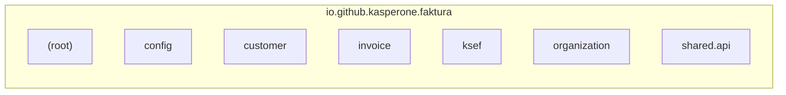

# Faktura: architecture overview

Lesson 01 · faktura @ `52ac414`

Sources: README.md L1–3

<!--
Welcome to the first lesson of the Faktura course. In this lesson we take a guided tour of the
whole repository: what the application is, how the monorepo is laid out, how the backend is
organised into packages, how a request travels through the system, how security is planned, and
which tests and quality gates keep the code honest.

Everything you will see is taken from one fixed commit of the repository, so the slides and the
code always match.
-->

---

# What Faktura is

<v-clicks>

- An **invoicing application**, Poland-focused, with a KSeF-ready roadmap
- A hands-on **Java learning project** at an early stage; the scope grows over time
- **Stack:** Java 25 · Spring Boot 4.1 · Maven | React · TypeScript · Vite | PostgreSQL 18 via Docker Compose
- The UI today is a shell: "Invoice workspace — coming soon."

</v-clicks>

Sources: README.md L3, L7, L11–15 · frontend/src/App.tsx L10

<!--
Let's start with what Faktura actually is.

[click] Faktura is an invoicing application. The README describes it as Poland-focused, with a
roadmap that is ready for KSeF, the Polish national e-invoicing system.

[click] It is also a learning project. The author comes from frontend work and uses Faktura to
learn Java and Spring Boot on the backend. The README says plainly that the project is at an
early stage and that its scope will grow.

[click] The stack has three parts. The backend is Java 25 with Spring Boot 4.1, built with Maven.
The frontend is React with TypeScript, built with Vite. The database is PostgreSQL 18, which runs
in Docker Compose.

[click] And to set expectations: the frontend today is a shell. Its main page shows a single line,
"Invoice workspace — coming soon." So this lesson is about the skeleton and the rules, not about
invoice features yet.
-->

---

# Monorepo layout

<v-clicks>

- `backend/` — a single Maven module, `io.github.kasperone:faktura-api`, Spring Boot parent 4.1.2
- `frontend/` — a Vite React SPA (React 19, Vite 8, TypeScript 5.9)
- `docker-compose.yml` — PostgreSQL 18 only; the application itself runs on the host
- `docs/` — architecture notes and ADRs

</v-clicks>

Sources: README.md L78–84 · AGENTS.md (Repository map) · backend/pom.xml L7–17 · frontend/package.json L16–33

<!--
The repository is a monorepo with two applications side by side.

[click] The backend folder is one Maven module. Its coordinates are io.github.kasperone,
faktura-api, and it inherits from the Spring Boot starter parent, version 4.1.2.

[click] The frontend folder is a single-page application built with Vite and React. The
package.json pins React 19, Vite 8 and TypeScript 5.9.

[click] At the root, docker-compose.yml starts only PostgreSQL. The README is explicit that the
application itself runs on your machine, not in a container, for now.

[click] Finally, the docs folder holds the architecture notes and the architecture decision
records, or ADRs. We will use one of those ADRs when we talk about security.
-->

---

# Backend packages

Generated from the context pack's Java package graph (own packages only, main sources). No edges:
no own package imports another one yet.

Sources: context pack "Java package graph (own packages)" · backend/src/main/java/io/github/kasperone/faktura/**

<!--
This diagram was generated automatically from the backend's source code. It shows only the
packages that belong to Faktura itself, under io.github.kasperone.faktura, and it leaves out the
test code and external libraries such as Spring.

There are seven packages, and you may notice there are no arrows between them. That is a real
finding, not a drawing mistake: at this commit, no Faktura package imports another Faktura
package. The only imports go to Spring and to java.util. Keep that in mind; on the next slide we
will see why that is fine for now.
-->

---

# What lives in each package

<v-clicks>

- **root** — `FakturaApplication`, the `@SpringBootApplication` entry point
- **config** — `WebConfig`: CORS rules for `/api/**`
- **shared.api** — `ApiPingController`: `GET /api/v1/ping`
- **Feature packages** (package-by-feature), still only `package-info.java`:
  - `customer` — buyer contacts, billing details
  - `invoice` — documents, line items, numbering
  - `organization` — seller profile, bank accounts, branding
  - `ksef` — KSeF submissions, status, credentials (future phase)

</v-clicks>

Sources: FakturaApplication.java L6–11 · config/WebConfig.java L8–21 · shared/api/ApiPingController.java L8–15 · {customer,invoice,organization,ksef}/package-info.java L1 · README.md L81 · AGENTS.md (Advisory)

<!--
Let's open the boxes one by one.

[click] The root package holds FakturaApplication, the class annotated with SpringBootApplication.
Its main method starts Spring.

[click] The config package has one class, WebConfig. It sets up CORS for every path under /api.
We will come back to it in the request flow.

[click] The shared.api package has ApiPingController, a tiny endpoint at /api/v1/ping. Today it is
the only real API endpoint.

[click] Then there are the feature packages. The README calls this layout package-by-feature: code
is grouped by business area, not by technical layer. Each feature package currently contains only
a package-info file that describes its purpose. Customer is about buyers, their contacts and
billing details. Invoice covers documents, line items and numbering. Organization is the seller's
profile, bank accounts and branding. KSeF is the integration with the national e-invoicing system,
and its description marks it as a future phase. The project's AGENTS.md confirms that these
feature folders are mostly placeholders today, which is why the diagram had no arrows.
-->

---

# Request flow (development)

<v-clicks>

1. Browser opens the SPA from the Vite dev server on port **5173**
2. A call to `/api/...` is **proxied** by Vite to `http://localhost:8080`
3. Spring Boot listens on `${SERVER_PORT:8080}`; CORS allows `/api/**` from `FAKTURA_CORS_ORIGINS` (default `http://localhost:5173`)
4. `ApiPingController` answers `GET /api/v1/ping` with `{"status": "ok"}`
5. Actuator exposes only `health` and `info`; health details are never shown

</v-clicks>

Sources: frontend/vite.config.ts L6–14 · README.md L54–66 · backend/src/main/resources/application.yml L11–27 · config/WebConfig.java L11–20 · shared/api/ApiPingController.java L9–15

<!--
Now let's follow one request through the system during local development.

[click] You open the app in the browser. It is served by the Vite dev server, which listens on
port 5173.

[click] When the frontend calls anything under /api, the Vite configuration proxies that request to
the backend at localhost port 8080. From the browser's point of view, everything stays on one
origin.

[click] On the backend, Spring Boot listens on port 8080 unless the SERVER_PORT variable says
otherwise. WebConfig also allows cross-origin calls to /api paths, but only from the origins listed
in FAKTURA_CORS_ORIGINS, which defaults to the Vite dev server address.

[click] The request reaches ApiPingController. For GET /api/v1/ping it returns a small JSON object
with status ok.

[click] Next to the API, Spring Boot Actuator exposes only two endpoints, health and info, and the
health endpoint never shows details. The datasource is configured for PostgreSQL through
environment variables, but none of the Java sources in this commit query the database yet.
-->

---

# Security model: the decision (ADR 0002)

<v-clicks>

- **Status: Accepted** (2026-11-09) — for Phase 1, which adds login and protected APIs
- **Server-side HTTP sessions** managed by Spring Security; the session id lives in a cookie
- Cookie flags: **HttpOnly**, **Secure** (HTTPS in production), **SameSite**
- **CSRF** with the cookie-to-header pattern: the SPA echoes the token in a header such as `X-XSRF-TOKEN` on mutating requests
- Same origin in practice: the Vite `/api` proxy in development
- Out of scope: JWTs and tokens in `localStorage` / `sessionStorage`

</v-clicks>

Sources: docs/adr/0002-session-cookie-auth-csrf.md L1–11

<!--
Security in Faktura is decided in an architecture decision record, ADR 0002.

[click] The ADR is accepted, dated November 9, 2026. Its context is Phase 1 of the project, which
adds login and protected APIs.

[click] The decision is to use classic server-side HTTP sessions, managed by Spring Security. The
browser only holds a session id in a cookie; the session state stays on the server.

[click] That cookie gets three protective flags. HttpOnly means page JavaScript cannot read it.
Secure means it is only sent over HTTPS in production. SameSite limits when the browser attaches it
to requests that start on other websites.

[click] Because the browser sends cookies automatically, the API also needs CSRF protection. The
ADR picks Spring's cookie-to-header pattern: the server hands out a CSRF token, and the SPA sends it
back in a header, for example X-XSRF-TOKEN, on every request that changes data.

[click] To keep things simple, browser requests stay on the same origin. In development that is
exactly the Vite proxy we just saw.

[click] And the ADR explicitly rules out JWTs and keeping tokens in localStorage or sessionStorage
for this decision.
-->

---

# Security model: status at this commit

<v-clicks>

- **Planned, not implemented:** `backend/pom.xml` has no Spring Security dependency yet
- The ADR's Phase 1 list: a `SecurityConfig`, CSRF for browser clients, cookie flags per environment, frontend sending the CSRF header on writes
- **In place today:** a CORS allow-list for `/api/**` and a minimal Actuator surface
- Why not JWT in `localStorage`? Any XSS could steal the token, and revoking it needs extra infrastructure

</v-clicks>

Sources: backend/pom.xml L35–64 · docs/adr/0002-session-cookie-auth-csrf.md L15, L18 · AGENTS.md (Advisory) · config/WebConfig.java L15–20 · application.yml L14–23

<!--
So what is actually in the code at this commit?

[click] Authentication is planned but not implemented. The backend's pom.xml lists web MVC,
Actuator, JDBC and the PostgreSQL driver, but no Spring Security. AGENTS.md also lists auth under
Phase 1 and later.

[click] The ADR spells out what Phase 1 must add: a security configuration with session creation
and authorization rules, CSRF enabled for browser clients, cookie flags configured for development
and production, and a frontend API client that sends the CSRF header on writes.

[click] What already exists is smaller: the CORS allow-list we saw in WebConfig, and an Actuator
setup that exposes only health and info.

[click] One more point from the ADR, because it is a common question: why not a JWT in
localStorage? The ADR rejects it because any cross-site scripting bug could read and steal the
token, and revoking it would need extra infrastructure. Ending a server session is much simpler.
-->

---

# Tests

<v-clicks>

- `FakturaApplicationTests` — `@SpringBootTest` with the `test` profile: the context loads
- `application-test.yml` turns off DataSource auto-configuration, so it passes without Postgres
- `ApiPingControllerTest` — `@WebMvcTest` + `MockMvc`: `GET /api/v1/ping` returns 200 and `status = ok`
- Run them all with `cd backend && ./mvnw verify`

</v-clicks>

Sources: FakturaApplicationTests.java L7–12 · backend/src/test/resources/application-test.yml L1–10 · ApiPingControllerTest.java L13–24 · README.md L70–72 · AGENTS.md (Verify before push)

<!--
Let's look at the tests that exist today.

[click] FakturaApplicationTests is a SpringBootTest that runs with the test profile. Its only test
checks that the whole Spring context starts.

[click] The test profile's configuration switches off the DataSource auto-configuration and the
database health check. That is why this test passes even when PostgreSQL is not running.

[click] ApiPingControllerTest is narrower. It is a WebMvcTest that loads only the web layer for the
ping controller and uses MockMvc to call GET /api/v1/ping. It expects HTTP 200 and a JSON field
status equal to ok.

[click] All backend tests run with one command: go to the backend folder and run the Maven wrapper
with verify.
-->

---

# Quality gates in `mvn verify`

<v-clicks depth="2">

- **Spotless** checks Google Java Format 1.27.0 in the `verify` phase (also unused imports, trailing whitespace, final newline)
- **ArchUnit 1.4.1** — `ArchitectureRulesTest` on the compiled main classes:
  - `config` and `shared` must not depend on feature packages
  - each feature (`customer`, `invoice`, `organization`, `ksef`) must not depend on the others
  - feature rules use `allowEmptyShould(true)` until real types exist

</v-clicks>

Sources: backend/pom.xml L28–33, L72–95 · ArchitectureRulesTest.java L16–104 · AGENTS.md (Hard constraints)

<!--
Tests are only part of the safety net. Maven's verify phase also runs two quality gates.

[click] The first is Spotless. It is bound to the verify phase and checks that all Java code
follows Google Java Format, version 1.27.0. It also checks for unused imports, trailing whitespace
and a missing newline at the end of a file. If the formatting is off, the build fails.

[click] The second is ArchUnit, version 1.4.1, through the ArchitectureRulesTest class. It loads
the compiled production classes and checks package boundaries.

[click] The config package and the shared package must not depend on any feature package.

[click] And each feature package must not depend on any other feature. Customer cannot reach into
invoice, invoice cannot reach into KSeF, and so on.

[click] Because the feature packages contain no classes yet, those feature rules allow an empty
match for now. The test's own comment says they become strict as soon as real types exist. This
is the rule that will keep the arrows in our package diagram under control.
-->

---

# Continuous integration

<v-clicks>

- **gitleaks** — fails on committed secrets
- **backend** — `./mvnw -B verify` with a Postgres service: tests, Spotless, ArchUnit
- **frontend** — `npm ci`, ESLint (typescript-eslint, React Hooks rules), `tsc -b && vite build`

</v-clicks>

Sources: README.md L86–88 · AGENTS.md (Hard constraints) · frontend/package.json L9–10 · frontend/eslint.config.js L8–32

<!--
The same checks also run in GitHub Actions, as three jobs.

[click] The first job is gitleaks, which scans for secrets that should never be committed.

[click] The backend job runs the Maven wrapper's verify in batch mode, with a PostgreSQL service
available, so tests, Spotless and ArchUnit all run in CI exactly as they do locally.

[click] The frontend job installs dependencies with npm ci, runs ESLint with the TypeScript and
React Hooks rules, and then builds the app: first a TypeScript type check with tsc, then the Vite
production build.
-->

---

# Recap

<v-clicks>

- Monorepo: Spring Boot API in `backend/`, React + Vite SPA in `frontend/`, Postgres in Docker
- Package-by-feature backend; features are placeholders, guarded by ArchUnit
- Dev requests: browser → Vite proxy `/api` → Spring Boot on 8080
- Security: session cookies + CSRF decided in ADR 0002, to be built in Phase 1
- Gates: tests, Spotless, ArchUnit, gitleaks and the frontend lint/build, locally and in CI

</v-clicks>

<!--
Let's sum up.

[click] Faktura is a monorepo: a Spring Boot API in the backend folder, a React and Vite
single-page app in the frontend folder, and PostgreSQL running in Docker.

[click] The backend is organised by feature. The feature packages are still placeholders, but
ArchUnit already guards their boundaries.

[click] In development, the browser talks to the Vite dev server, which forwards API calls to Spring
Boot on port 8080.

[click] Security is decided but not built: server-side sessions with secure cookies and CSRF
protection, as recorded in ADR 0002, arrive in Phase 1.

[click] And every change passes the same gates locally and in CI: tests, formatting, architecture
rules, secret scanning and the frontend lint and build.

In the next lessons we will go deeper into each of these parts.
-->

---

# Sources

All from faktura at `52ac4142b8b30d558c49ddc8668e85dd58f54c03` (context pack `01-architecture`):

- `README.md`, `AGENTS.md`
- `docs/adr/0002-session-cookie-auth-csrf.md`
- `backend/pom.xml`
- `backend/src/main/resources/application.yml`
- `backend/src/test/resources/application-test.yml`
- `frontend/package.json`, `frontend/vite.config.ts`
- `frontend/eslint.config.js`, `frontend/src/App.tsx`

`backend/src/main/java/io/github/kasperone/faktura/`
- `FakturaApplication.java`, `config/WebConfig.java`
- `shared/api/ApiPingController.java`
- `{customer,invoice,organization,ksef}/package-info.java`

`backend/src/test/java/io/github/kasperone/faktura/`
- `FakturaApplicationTests.java`
- `architecture/ArchitectureRulesTest.java`
- `shared/api/ApiPingControllerTest.java`

<!--
This last slide lists every file the lesson is based on, all taken from the same commit of the
repository. If you want to check any statement from this lesson, open these files at that commit.
-->
