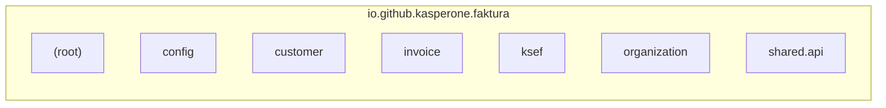

# Faktura: przegląd architektury

Lekcja 01 · faktura @ `52ac414`

Źródła: README.md L1–3

<!--
Witaj w pierwszej lekcji kursu Faktura. W tej lekcji przejdziemy razem przez całe repozytorium:
czym jest aplikacja, jak zorganizowane jest monorepo, jak backend dzieli się na pakiety, jak
żądanie przechodzi przez system, jak zaplanowano bezpieczeństwo oraz jakie testy i bramki jakości
pilnują kodu.

Wszystko, co zobaczysz, pochodzi z jednego, ustalonego commita repozytorium, więc slajdy i kod
zawsze do siebie pasują.
-->

---

# Czym jest Faktura

<v-clicks>

- **Aplikacja do fakturowania** nastawiona na Polskę, z roadmapą przygotowaną pod KSeF
- Praktyczny **projekt do nauki Javy** na wczesnym etapie; zakres będzie rósł
- **Stos:** Java 25 · Spring Boot 4.1 · Maven | React · TypeScript · Vite | PostgreSQL 18 przez Docker Compose
- Interfejs jest dziś tylko szkieletem: „Invoice workspace — coming soon."

</v-clicks>

Źródła: README.md L3, L7, L11–15 · frontend/src/App.tsx L10

<!--
Zacznijmy od tego, czym właściwie jest Faktura.

[click] Faktura to aplikacja do wystawiania faktur. README opisuje ją jako nastawioną na Polskę, z
roadmapą przygotowaną pod KSeF, czyli krajowy system e-fakturowania.

[click] To także projekt do nauki. Autor wywodzi się z frontendu i używa Faktury, żeby nauczyć się
Javy i Spring Boota po stronie backendu. README mówi wprost, że projekt jest na wczesnym etapie, a
jego zakres będzie rósł.

[click] Stos technologiczny ma trzy części. Backend to Java 25 ze Spring Bootem 4.1, budowany
Mavenem. Frontend to React z TypeScriptem, budowany przez Vite. Baza danych to PostgreSQL 18, który
działa w Docker Compose.

[click] I żeby nie budzić złudzeń: frontend jest dziś tylko szkieletem. Jego główna strona pokazuje
jedną linijkę: „Invoice workspace — coming soon". Ta lekcja dotyczy więc szkieletu i zasad, a nie
jeszcze funkcji związanych z fakturami.
-->

---

# Układ monorepo

<v-clicks>

- `backend/` — jeden moduł Mavena, `io.github.kasperone:faktura-api`, parent Spring Boot 4.1.2
- `frontend/` — SPA w React budowane przez Vite (React 19, Vite 8, TypeScript 5.9)
- `docker-compose.yml` — tylko PostgreSQL 18; sama aplikacja działa na hoście
- `docs/` — notatki architektoniczne i ADR-y

</v-clicks>

Źródła: README.md L78–84 · AGENTS.md (Repository map) · backend/pom.xml L7–17 · frontend/package.json L16–33

<!--
Repozytorium to monorepo z dwiema aplikacjami obok siebie.

[click] Folder backend to jeden moduł Mavena. Jego współrzędne to io.github.kasperone, faktura-api,
a jego rodzicem jest Spring Boot starter parent w wersji 4.1.2.

[click] Folder frontend to aplikacja jednostronicowa, czyli SPA, zbudowana na Vite i Reakcie. Plik
package.json przypina Reacta 19, Vite 8 i TypeScripta 5.9.

[click] W katalogu głównym plik docker-compose.yml uruchamia tylko PostgreSQL. README wyraźnie
mówi, że sama aplikacja działa na razie na twoim komputerze, a nie w kontenerze.

[click] Na koniec folder docs zawiera notatki architektoniczne i rekordy decyzji architektonicznych,
czyli ADR-y. Z jednego z nich skorzystamy, gdy będziemy mówić o bezpieczeństwie.
-->

---

# Pakiety backendu

Wygenerowane z grafu pakietów Javy w context packu (tylko własne pakiety, kod main). Brak krawędzi:
żaden własny pakiet nie importuje jeszcze innego.

Źródła: context pack „Java package graph (own packages)" · backend/src/main/java/io/github/kasperone/faktura/**

<!--
Ten diagram został wygenerowany automatycznie z kodu źródłowego backendu. Pokazuje tylko pakiety
należące do samej Faktury, pod io.github.kasperone.faktura, i pomija kod testów oraz zewnętrzne
biblioteki, takie jak Spring.

Pakietów jest siedem i być może zauważysz, że nie ma między nimi strzałek. To prawdziwe ustalenie,
a nie błąd w rysunku: w tym commicie żaden pakiet Faktury nie importuje innego pakietu Faktury.
Jedyne importy prowadzą do Springa i do java.util. Zapamiętaj to; na następnym slajdzie zobaczymy,
dlaczego na razie jest to w porządku.
-->

---

# Co jest w każdym pakiecie

<v-clicks>

- **root** — `FakturaApplication`, punkt wejścia z `@SpringBootApplication`
- **config** — `WebConfig`: reguły CORS dla `/api/**`
- **shared.api** — `ApiPingController`: `GET /api/v1/ping`
- **Pakiety funkcjonalne** (package-by-feature), na razie tylko `package-info.java`:
  - `customer` — kontakty nabywców, dane rozliczeniowe
  - `invoice` — dokumenty, pozycje, numeracja
  - `organization` — profil sprzedawcy, konta bankowe, branding
  - `ksef` — wysyłki do KSeF, status, poświadczenia (przyszła faza)

</v-clicks>

Źródła: FakturaApplication.java L6–11 · config/WebConfig.java L8–21 · shared/api/ApiPingController.java L8–15 · {customer,invoice,organization,ksef}/package-info.java L1 · README.md L81 · AGENTS.md (Advisory)

<!--
Otwórzmy te pudełka po kolei.

[click] Pakiet główny zawiera FakturaApplication, klasę z adnotacją SpringBootApplication. Jej metoda
main uruchamia Springa.

[click] Pakiet config ma jedną klasę, WebConfig. Konfiguruje ona CORS dla wszystkich ścieżek pod
/api. Wrócimy do niej przy przepływie żądania.

[click] Pakiet shared.api zawiera ApiPingController, mały endpoint pod adresem /api/v1/ping. Dziś to
jedyny prawdziwy endpoint API.

[click] Dalej są pakiety funkcjonalne. README nazywa ten układ package-by-feature: kod jest
pogrupowany według obszaru biznesowego, a nie według warstwy technicznej. Każdy pakiet funkcjonalny
zawiera obecnie tylko plik package-info, który opisuje jego przeznaczenie. Customer dotyczy
nabywców, ich kontaktów i danych rozliczeniowych. Invoice obejmuje dokumenty, pozycje i numerację.
Organization to profil sprzedawcy, konta bankowe i branding. KSeF to integracja z krajowym systemem
e-fakturowania, a jego opis oznacza ją jako przyszłą fazę. Plik AGENTS.md projektu potwierdza, że
te foldery funkcjonalne są dziś głównie zaślepkami, i dlatego na diagramie nie było strzałek.
-->

---

# Przepływ żądania (development)

<v-clicks>

1. Przeglądarka otwiera SPA z serwera deweloperskiego Vite na porcie **5173**
2. Wywołanie `/api/...` Vite przekazuje przez **proxy** do `http://localhost:8080`
3. Spring Boot nasłuchuje na `${SERVER_PORT:8080}`; CORS dopuszcza `/api/**` z `FAKTURA_CORS_ORIGINS` (domyślnie `http://localhost:5173`)
4. `ApiPingController` odpowiada na `GET /api/v1/ping` obiektem `{"status": "ok"}`
5. Actuator udostępnia tylko `health` i `info`; szczegóły health nigdy nie są pokazywane

</v-clicks>

Źródła: frontend/vite.config.ts L6–14 · README.md L54–66 · backend/src/main/resources/application.yml L11–27 · config/WebConfig.java L11–20 · shared/api/ApiPingController.java L9–15

<!--
Teraz prześledźmy jedno żądanie przez system podczas lokalnego developmentu.

[click] Otwierasz aplikację w przeglądarce. Serwuje ją serwer deweloperski Vite, który nasłuchuje na
porcie 5173.

[click] Gdy frontend wywołuje cokolwiek pod /api, konfiguracja Vite przekazuje to żądanie przez proxy
do backendu na localhost, na porcie 8080. Z punktu widzenia przeglądarki wszystko zostaje w jednym
originie.

[click] Na backendzie Spring Boot nasłuchuje na porcie 8080, chyba że zmienna SERVER_PORT mówi
inaczej. WebConfig dopuszcza też wywołania cross-origin do ścieżek /api, ale tylko z originów
wymienionych w FAKTURA_CORS_ORIGINS, która domyślnie zawiera adres serwera deweloperskiego Vite.

[click] Żądanie trafia do ApiPingController. Dla GET /api/v1/ping zwraca on mały obiekt JSON ze
statusem ok.

[click] Obok API Spring Boot Actuator udostępnia tylko dwa endpointy, health i info, a endpoint
health nigdy nie pokazuje szczegółów. Źródło danych jest skonfigurowane dla PostgreSQL przez zmienne
środowiskowe, ale żaden plik źródłowy Javy w tym commicie nie odpytuje jeszcze bazy danych.
-->

---

# Model bezpieczeństwa: decyzja (ADR 0002)

<v-clicks>

- **Status: Accepted** (2026-11-09) — dla Fazy 1, która dodaje logowanie i chronione API
- **Sesje HTTP po stronie serwera** zarządzane przez Spring Security; identyfikator sesji jest w cookie
- Flagi cookie: **HttpOnly**, **Secure** (HTTPS na produkcji), **SameSite**
- **CSRF** we wzorcu cookie-to-header: SPA odsyła token w nagłówku, np. `X-XSRF-TOKEN`, przy żądaniach zmieniających dane
- W praktyce ten sam origin: proxy `/api` w Vite podczas developmentu
- Poza zakresem: JWT i tokeny w `localStorage` / `sessionStorage`

</v-clicks>

Źródła: docs/adr/0002-session-cookie-auth-csrf.md L1–11

<!--
Bezpieczeństwo w Fakturze zostało ustalone w rekordzie decyzji architektonicznej, ADR 0002.

[click] ADR jest przyjęty i ma datę 9 listopada 2026. Jego kontekstem jest Faza 1 projektu, która
dodaje logowanie i chronione API.

[click] Decyzja to klasyczne sesje HTTP po stronie serwera, zarządzane przez Spring Security.
Przeglądarka trzyma tylko identyfikator sesji w cookie; stan sesji zostaje na serwerze.

[click] To cookie dostaje trzy flagi ochronne. HttpOnly oznacza, że JavaScript na stronie nie może
go odczytać. Secure oznacza, że na produkcji jest wysyłane tylko przez HTTPS. SameSite ogranicza
sytuacje, w których przeglądarka dołącza je do żądań wychodzących z innych stron.

[click] Ponieważ przeglądarka wysyła cookies automatycznie, API potrzebuje też ochrony przed CSRF.
ADR wybiera springowy wzorzec cookie-to-header: serwer wydaje token CSRF, a SPA odsyła go w
nagłówku, na przykład X-XSRF-TOKEN, przy każdym żądaniu, które zmienia dane.

[click] Dla prostoty żądania przeglądarki pozostają w tym samym originie. Podczas developmentu
zapewnia to właśnie proxy Vite, które przed chwilą widzieliśmy.

[click] ADR w tej decyzji wprost wyklucza też JWT i trzymanie tokenów w localStorage lub
sessionStorage.
-->

---

# Model bezpieczeństwa: stan w tym commicie

<v-clicks>

- **Zaplanowane, niezaimplementowane:** `backend/pom.xml` nie ma jeszcze zależności Spring Security
- Lista Fazy 1 z ADR: `SecurityConfig`, CSRF dla klientów przeglądarkowych, flagi cookie zależne od środowiska, frontend wysyłający nagłówek CSRF przy zapisach
- **Już dziś:** lista dozwolonych originów CORS dla `/api/**` i minimalna powierzchnia Actuatora
- Dlaczego nie JWT w `localStorage`? Każdy XSS mógłby ukraść token, a jego unieważnienie wymaga dodatkowej infrastruktury

</v-clicks>

Źródła: backend/pom.xml L35–64 · docs/adr/0002-session-cookie-auth-csrf.md L15, L18 · AGENTS.md (Advisory) · config/WebConfig.java L15–20 · application.yml L14–23

<!--
Co więc faktycznie jest w kodzie w tym commicie?

[click] Uwierzytelnianie jest zaplanowane, ale niezaimplementowane. Plik pom.xml backendu zawiera
web MVC, Actuatora, JDBC i sterownik PostgreSQL, ale nie ma w nim Spring Security. AGENTS.md też
umieszcza uwierzytelnianie w Fazie 1 i później.

[click] ADR wymienia, co musi dodać Faza 1: konfigurację bezpieczeństwa z tworzeniem sesji i
regułami autoryzacji, CSRF włączony dla klientów przeglądarkowych, flagi cookie skonfigurowane dla
developmentu i produkcji oraz klienta API we frontendzie, który wysyła nagłówek CSRF przy zapisach.

[click] To, co już istnieje, jest skromniejsze: lista dozwolonych originów CORS, którą widzieliśmy w
WebConfig, oraz konfiguracja Actuatora, która udostępnia tylko health i info.

[click] Jeszcze jedna rzecz z ADR, bo to częste pytanie: dlaczego nie JWT w localStorage? ADR
odrzuca to rozwiązanie, ponieważ każdy błąd typu cross-site scripting mógłby odczytać i ukraść
token, a jego unieważnienie wymagałoby dodatkowej infrastruktury. Zakończenie sesji na serwerze jest
znacznie prostsze.
-->

---

# Testy

<v-clicks>

- `FakturaApplicationTests` — `@SpringBootTest` z profilem `test`: kontekst się ładuje
- `application-test.yml` wyłącza autokonfigurację DataSource, więc test przechodzi bez Postgresa
- `ApiPingControllerTest` — `@WebMvcTest` + `MockMvc`: `GET /api/v1/ping` zwraca 200 i `status = ok`
- Wszystkie uruchomisz przez `cd backend && ./mvnw verify`

</v-clicks>

Źródła: FakturaApplicationTests.java L7–12 · backend/src/test/resources/application-test.yml L1–10 · ApiPingControllerTest.java L13–24 · README.md L70–72 · AGENTS.md (Verify before push)

<!--
Spójrzmy na testy, które istnieją dzisiaj.

[click] FakturaApplicationTests to test SpringBootTest uruchamiany z profilem test. Jego jedyny test
sprawdza, czy cały kontekst Springa się uruchamia.

[click] Konfiguracja profilu testowego wyłącza autokonfigurację DataSource oraz health check bazy
danych. Dlatego ten test przechodzi nawet wtedy, gdy PostgreSQL nie działa.

[click] ApiPingControllerTest jest węższy. To WebMvcTest, który ładuje tylko warstwę webową dla
kontrolera ping i za pomocą MockMvc wywołuje GET /api/v1/ping. Oczekuje kodu HTTP 200 i pola JSON
status równego ok.

[click] Wszystkie testy backendu uruchamia jedno polecenie: przejdź do folderu backend i uruchom
wrapper Mavena z celem verify.
-->

---

# Bramki jakości w `mvn verify`

<v-clicks depth="2">

- **Spotless** sprawdza Google Java Format 1.27.0 w fazie `verify` (także nieużywane importy, białe znaki na końcu linii, końcową nową linię)
- **ArchUnit 1.4.1** — `ArchitectureRulesTest` na skompilowanych klasach main:
  - `config` i `shared` nie mogą zależeć od pakietów funkcjonalnych
  - żaden pakiet funkcjonalny (`customer`, `invoice`, `organization`, `ksef`) nie może zależeć od pozostałych
  - reguły dla pakietów funkcjonalnych używają `allowEmptyShould(true)`, dopóki nie powstaną prawdziwe typy

</v-clicks>

Źródła: backend/pom.xml L28–33, L72–95 · ArchitectureRulesTest.java L16–104 · AGENTS.md (Hard constraints)

<!--
Testy to tylko część siatki bezpieczeństwa. Faza verify w Mavenie uruchamia też dwie bramki jakości.

[click] Pierwsza to Spotless. Jest podpięty pod fazę verify i sprawdza, czy cały kod Javy jest
zgodny z Google Java Format w wersji 1.27.0. Sprawdza też nieużywane importy, białe znaki na końcu
linii i brak nowej linii na końcu pliku. Jeśli formatowanie się nie zgadza, build kończy się
błędem.

[click] Druga to ArchUnit w wersji 1.4.1, w postaci klasy ArchitectureRulesTest. Ładuje ona
skompilowane klasy produkcyjne i sprawdza granice pakietów.

[click] Pakiety config i shared nie mogą zależeć od żadnego pakietu funkcjonalnego.

[click] A żaden pakiet funkcjonalny nie może zależeć od innego. Customer nie może sięgać do invoice,
invoice nie może sięgać do KSeF i tak dalej.

[click] Ponieważ pakiety funkcjonalne nie zawierają jeszcze klas, te reguły na razie dopuszczają
puste dopasowanie. Komentarz w samym teście mówi, że staną się ścisłe, gdy tylko pojawią się
prawdziwe typy. To właśnie ta reguła będzie trzymać w ryzach strzałki na naszym diagramie pakietów.
-->

---

# Ciągła integracja

<v-clicks>

- **gitleaks** — kończy się błędem, gdy w repozytorium są zacommitowane sekrety
- **backend** — `./mvnw -B verify` z usługą Postgres: testy, Spotless, ArchUnit
- **frontend** — `npm ci`, ESLint (typescript-eslint, reguły React Hooks), `tsc -b && vite build`

</v-clicks>

Źródła: README.md L86–88 · AGENTS.md (Hard constraints) · frontend/package.json L9–10 · frontend/eslint.config.js L8–32

<!--
Te same kontrole działają też w GitHub Actions, jako trzy joby.

[click] Pierwszy job to gitleaks, który szuka sekretów, które nigdy nie powinny trafić do
repozytorium.

[click] Job backendu uruchamia verify przez wrapper Mavena w trybie wsadowym, z dostępną usługą
PostgreSQL, więc testy, Spotless i ArchUnit działają w CI dokładnie tak samo jak lokalnie.

[click] Job frontendu instaluje zależności przez npm ci, uruchamia ESLinta z regułami TypeScriptu i
React Hooks, a potem buduje aplikację: najpierw sprawdzenie typów TypeScriptu przez tsc, potem
produkcyjny build Vite.
-->

---

# Podsumowanie

<v-clicks>

- Monorepo: API w Spring Boot w `backend/`, SPA w React + Vite w `frontend/`, Postgres w Dockerze
- Backend package-by-feature; pakiety funkcjonalne to zaślepki pilnowane przez ArchUnit
- Żądania w developmencie: przeglądarka → proxy Vite `/api` → Spring Boot na 8080
- Bezpieczeństwo: sesyjne cookies + CSRF ustalone w ADR 0002, do zbudowania w Fazie 1
- Bramki: testy, Spotless, ArchUnit, gitleaks oraz lint i build frontendu, lokalnie i w CI

</v-clicks>

<!--
Podsumujmy.

[click] Faktura to monorepo: API w Spring Boot w folderze backend, aplikacja jednostronicowa w
React i Vite w folderze frontend oraz PostgreSQL działający w Dockerze.

[click] Backend jest zorganizowany według funkcji biznesowych. Pakiety funkcjonalne są wciąż
zaślepkami, ale ArchUnit już pilnuje ich granic.

[click] Podczas developmentu przeglądarka rozmawia z serwerem deweloperskim Vite, który przekazuje
wywołania API do Spring Boota na porcie 8080.

[click] Bezpieczeństwo jest ustalone, ale jeszcze niezbudowane: sesje po stronie serwera z
bezpiecznymi cookies i ochroną CSRF, zapisane w ADR 0002, pojawią się w Fazie 1.

[click] A każda zmiana przechodzi przez te same bramki lokalnie i w CI: testy, formatowanie, reguły
architektury, skanowanie sekretów oraz lint i build frontendu.

W kolejnych lekcjach zagłębimy się w każdą z tych części.
-->

---

# Źródła

Wszystko z repozytorium faktura w commicie `52ac4142b8b30d558c49ddc8668e85dd58f54c03` (context pack `01-architecture`):

- `README.md`, `AGENTS.md`
- `docs/adr/0002-session-cookie-auth-csrf.md`
- `backend/pom.xml`
- `backend/src/main/resources/application.yml`
- `backend/src/test/resources/application-test.yml`
- `frontend/package.json`, `frontend/vite.config.ts`
- `frontend/eslint.config.js`, `frontend/src/App.tsx`

`backend/src/main/java/io/github/kasperone/faktura/`
- `FakturaApplication.java`, `config/WebConfig.java`
- `shared/api/ApiPingController.java`
- `{customer,invoice,organization,ksef}/package-info.java`

`backend/src/test/java/io/github/kasperone/faktura/`
- `FakturaApplicationTests.java`
- `architecture/ArchitectureRulesTest.java`
- `shared/api/ApiPingControllerTest.java`

<!--
Ten ostatni slajd wymienia wszystkie pliki, na których opiera się lekcja, wszystkie z tego samego
commita repozytorium. Jeśli chcesz sprawdzić dowolne stwierdzenie z tej lekcji, otwórz te pliki w
tym commicie.
-->
